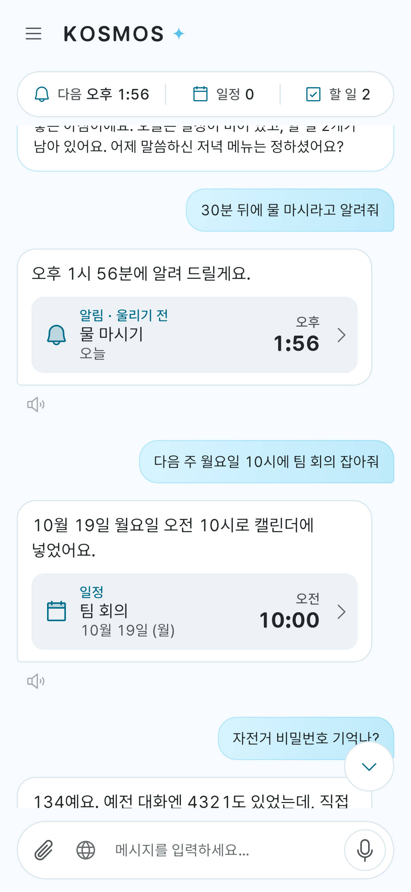
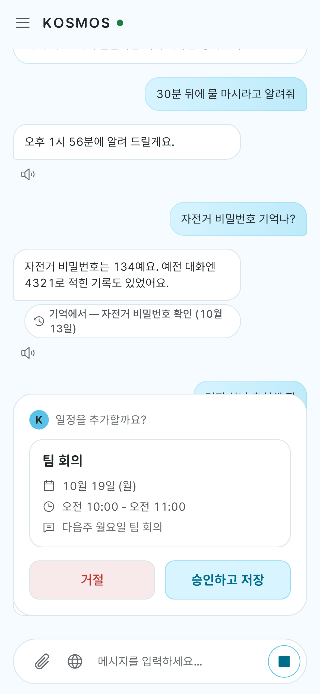
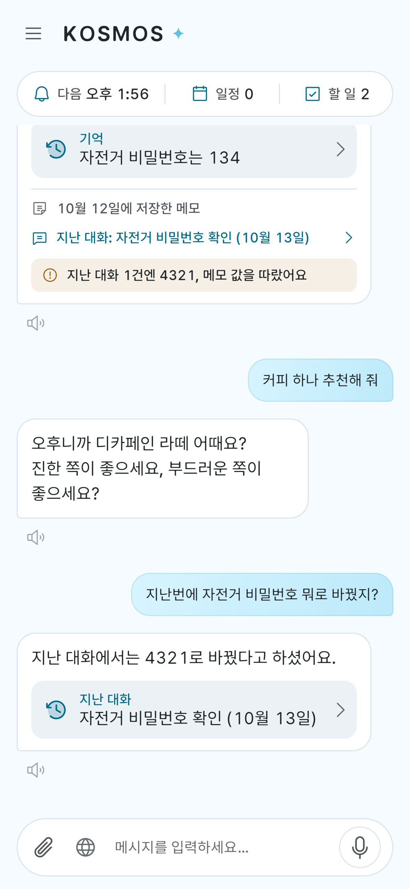
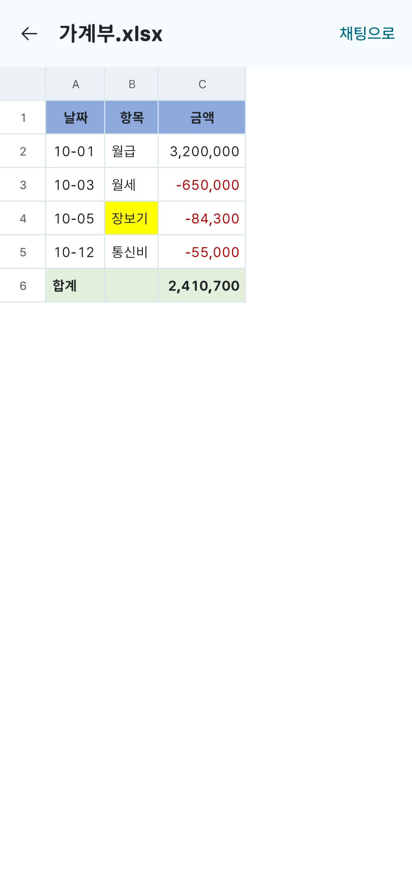
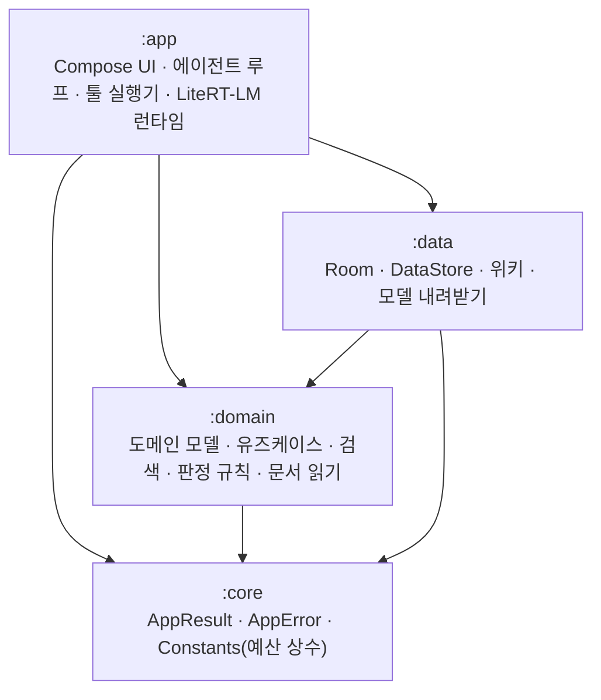
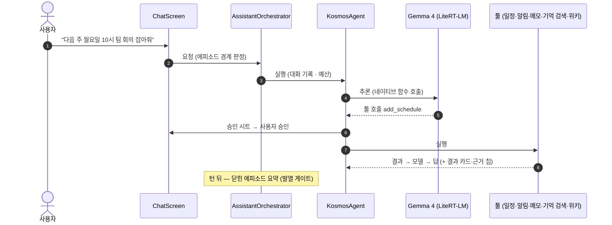

# KOSMOS — 휴대폰 안에서만 생각하는 AI 비서
> 서버 없이 기기 안의 **Gemma 4 E4B**(INT4, 약 3.6GB)로 대화·일정·알림·메모·기억을 다루는 안드로이드 개인 비서.
> 대화를 주제별 에피소드로 나눠 기억하고, 필요할 때 스스로 찾아 근거와 함께 답합니다.

**사용 안내**: [한국어](docs/guide/USER_GUIDE.md) | [English](docs/guide/USER_GUIDE.en.md)

  
  
  
  

화면은 합성 데이터로 테스트가 그린 것입니다(`ScreenCatalogTest`).

---

## 한눈에

- **무엇**: 말로 부탁하면 일정·알림·메모를 만들고, 지난 대화와 메모를 찾아 답하는 비서. 쓰기 작업은 모두 사용자 승인을 거칩니다.
- **제약**: 모델 하나(4B, INT4)가 휴대폰 GPU 에서 돈다 — 쓸 수 있는 문맥은 수천 토큰, 메모리는 약 5GB. 대상 기기는 Galaxy S25 Ultra(12GB).
- **원칙**: 개인정보는 기기 밖으로 나가지 않는다(예외는 사용자가 켜는 위키백과 검색과 모델 내려받기). 추정이 아니라 **실측으로 결정한다**.
- **기간·규모**: 2026-05 ~ 현재, 100여 회차. 결정 기록 [ADR](docs/architecture.md) 29개, 재현 실험 [`scratch/lab/`](scratch/lab).

## 무엇을 할 수 있나

| 기능 | 설명 |
|---|---|
| 대화와 에피소드 기억 | 세션 없이 하나의 연속 대화. 30분 쉬거나 문맥이 차면 에피소드로 닫고 기기 안에서 요약 → 검색 가능한 기억이 됩니다 |
| 일정·알림·할 일 | "다음 주 월요일 10시 팀 회의" → 승인 카드 → 앱과 기기 캘린더에 등록. 정한 시각에 울리는 알림, 월 캘린더·공휴일 |
| 메모와 프로필 | "기억해줘"로 메모, 대화에서 뽑은 프로필 제안. 사실만 말하면 저장하기 전에 먼저 묻습니다 |
| 음성 | 최대 30초 녹음을 모델이 직접 전사해 답합니다. 답 읽어 주기(기기 내장 TTS) |
| 첨부·문서 | 이미지·문서 첨부 질문. AI 없이 여는 문서 뷰어(PDF·엑셀·CSV·워드·한글, 엑셀 원본 서식) |
| 그 밖 | 아침 브리핑, 기억 정리(주간 회고·중복 합치기), 홈 위젯·빠른 설정 타일, 활동 기록(모든 툴 실행), 백업 |

## 풀어 낸 문제

온디바이스 4B 모델의 제약을 하나씩 실측으로 좁혀 간 기록입니다. 각 항목은 사람이 읽는 설명 문서나 원문 ADR 로 이어집니다.

1. **긴 대화에서 숫자가 깨지던 문제** — 일정 시각이 `202026-081717T010000` 으로 깨졌다. 실기기 대화 기록을 PC 실험으로 옮겨 가설 다섯 개를 하나씩 기각하고,
   **GPU 디코더의 FP16 정밀도 × 문맥 깊이**(약 1,850토큰 넘으면 깨짐)로 원인을 확정. 런타임이 설정을 열기 전에는 예산을 발병점 아래로 묶었고,
   열린 뒤 FP32 로 바꿔 예산을 되돌렸다. → [설명](docs/decisions/01-gpu-digit-corruption.md)
2. **검색 결과가 대화 예산을 넘치게 하던 문제** — 위키 결과가 턴 중간에 약 2,500토큰까지 무방비로 들어오던 구멍을 토큰 기준 500·문장 단위 절단으로 막고,
   한국어·숫자를 과소평가하던 토큰 추정을 실측으로 보정. → [설명](docs/decisions/02-tool-result-budget.md)
3. **툴을 부르지 않고 "했어요"라고만 하던 문제** — 처음엔 프롬프트로 가르친 자체 규약을 모델이 아예 쓰지 않아 네이티브 함수 호출로 바꿨고
   ([설명](docs/decisions/03-native-function-calling.md)), 긴 대화에서 다시 안 부르던 것은 "기록 모방"이라는 첫 진단을 실험으로 뒤집고 **지침의 위치**로 확정해
   매 사용자 말 앞에 짧은 지침 한 줄로 되살렸다. → [설명](docs/decisions/04-tool-reminder-position.md)
4. **임베딩 없이 기억 찾기** — 매 턴 붙이던 임베딩 검색이 한국어에서 분별력 0(무작위 수준)인 것을 재고 걷어 냈다(APK −28MB). 모델이 키워드를 뽑아 부르는
   검색 툴 + 한국어 2글자 묶음 점수로 바꿨고, 앱 조건으로 다시 재 실험 조건의 16/16 이 아닌 11/16 을 기준으로 삼았다. → [설명](docs/decisions/05-memory-search-without-embeddings.md)
5. **모델의 약점을 코드로 막기** — 되물었는데 저장하려 하거나, 사실만 말했는데 저장하거나, 앞에서 한 거절을 따라 하는 행동은 프롬프트로 안 고쳐졌다.
   앱이 판정해 막고(먼저 묻기·거절 턴을 모델 입력에서 빼기), 실험실 통과·실기기 실패의 차이(쌓인 대화 기록)까지 재현해 확인. → [설명](docs/decisions/06-guarding-small-model-behaviour.md)

## 알려진 한계

- **무겁다** — 모델 약 3.6GB 내려받기, 실행 중 메모리 약 5GB(12GB 기기 기준), 대화를 새로 읽는 턴의 첫 응답이 10초대. 앱이 백그라운드로 가면 모델을 내리므로 돌아올 때 다시 올린다.
- **기억하는 대화가 짧다** — 고정 몫(시스템 지시·툴 선언)을 빼면 대화 기록은 2~4턴 분량. 그 밖은 기억 검색에 기대고, 툴을 더 넣을 여유가 거의 없다.
- **4B 모델의 한계** — 툴 선택·정직한 답은 실측으로 대부분 맞지만 잔여 실패가 있고, 그 보정이 규칙(정규식) 기반이라 말투 변형에 약하다.
- **검증 환경** — 실제 추론은 실기기 한 대에서만 확인한다. 에뮬레이터는 지금 생성 단계가 막혀 있다(복구 예정).
- **한국어 전용** — 화면·지시·낭독이 한국어다(영어는 계획 중). 저장 데이터는 앱 샌드박스에 의존하고 따로 암호화하지 않는다(검토 예정).

앞으로의 순서는 [0.39.x 로드맵](docs/plans/0.39.x-roadmap.md)에 있습니다.

## AI 에이전트로 개발하는 방식

구현의 대부분은 AI 코딩 에이전트(Claude Code 등)가 맡고, 사람은 **방향·우선순위·결정·실기기 확인**을 맡습니다. 에이전트가 틀려도 드러나도록 절차를 저장소 규칙([AGENTS.md](AGENTS.md))으로 고정했습니다.

- **실측 선행** — 모델 행동에 대한 주장은 공식 문서 / 우리 실측 / API 계약 중 어느 근거인지 밝힌다([근거 등급](.agents/04_MODEL_EVIDENCE.md)). 프롬프트·툴 표면을 바꾸면 PC 실험실에서 먼저 잰다.
- **회차와 게이트** — 계획(사람 승인) → 마일스톤마다 `test lintDebug assembleDebug` 녹색 → 커밋 → 실기기 확인 목록. 기존 테스트 단언은 사람 확인 없이 바꾸지 않는다.
- **토큰 예산 불변식** — 예산·오버헤드 상수는 테스트가 지켜, 어림짐작으로 문구를 늘리면 빌드에서 깨진다.
- **교차 검증** — 다른 모델의 분석은 기준 버전·근거부터 대조하고, 독립 리뷰에는 결론이 아니라 변경분을 준다. 작업 방식은 [워크플로 가이드](docs/agent_workflow_guide.md).

## 구조

4개 Gradle 모듈입니다. 도메인은 안드로이드 의존이 없는 순수 Kotlin 이고, 에이전트·런타임·화면은 `:app` 에 있습니다.

## 기술 스택

| 분류 | 기술 |
| :--- | :--- |
| 언어·빌드 | Kotlin 2.4, AGP 9.3, Gradle KTS, KSP |
| UI | Jetpack Compose(Material 3), 라이트/다크 시맨틱 토큰, Phosphor 아이콘, 하다 라운드 글꼴 |
| 구조 | 4 모듈, Coroutines·Flow, Paging 3, Hilt |
| 온디바이스 AI | LiteRT-LM 0.18, Gemma 4 E4B INT4 (GPU FP32 활성화, CPU 폴백), 네이티브 함수 호출·제약 디코딩 |
| 저장 | Room, DataStore |
| 테스트 | JUnit4 · Robolectric · Compose UI 테스트 · 스크린샷 카탈로그(Roborazzi) · 토큰 예산 불변식 · PC 모델 실험실(Python, litert-lm) |

## 문서 지도

| 문서 | 내용 |
|---|---|
| [결정 설명](docs/decisions/README.md) | 핵심 결정을 사람이 읽는 한 편씩 — 문제·기각한 가설·확정·대가 |
| [architecture.md](docs/architecture.md) | 구조 + ADR(모든 주요 결정의 맥락과 근거) |
| [CHANGELOG.md](docs/CHANGELOG.md) | 회차별 기록 — 결함의 원인과 실측 수치까지 |
| [0.39.x 로드맵](docs/plans/0.39.x-roadmap.md) | 다음 회차들과 그 근거 |
| [AGENTS.md](AGENTS.md) · [워크플로](docs/agent_workflow_guide.md) | AI 에이전트 작업 규칙 |
| [DESIGN.md](docs/DESIGN.md) | UI 기준(v3) |
| [PRD.md](docs/PRD.md) | 제품 요구사항 |
| [실기기 확인 목록](docs/checklists/device_gate.md) | 테스트가 못 잡는 항목의 회차별 확인 |

## 라이선스

ⓒ 2026 jinwoo — [**CC BY-NC 4.0**](LICENSE.md)

- **비상업적 사용**: 자유롭게 사용·수정·재배포할 수 있습니다. 단, **출처(이 저장소와 저작자)를 명시**해야 합니다.
- **상업적 이용**: 허용되지 않습니다 — 원하시면 저작권자와 **별도 라이선스 협의**가 필요합니다.
- Gemma 모델은 저장소에 포함되지 않으며, 사용 시 Google 의 Gemma Terms of Use 를 따릅니다.
- 앱에 실린 글꼴 **하다 라운드**(Hada Type Foundry)는 [SIL Open Font License 1.1](app/src/main/assets/licenses/HadaRound-OFL.txt) 을 따릅니다 — 이 저장소의 CC BY-NC 4.0 과 별개입니다.
- 아이콘은 [Phosphor Icons](https://phosphoricons.com)(MIT, [고지](app/src/main/assets/licenses/Phosphor-MIT.txt))를 VectorDrawable 로 바꿔 씁니다.
