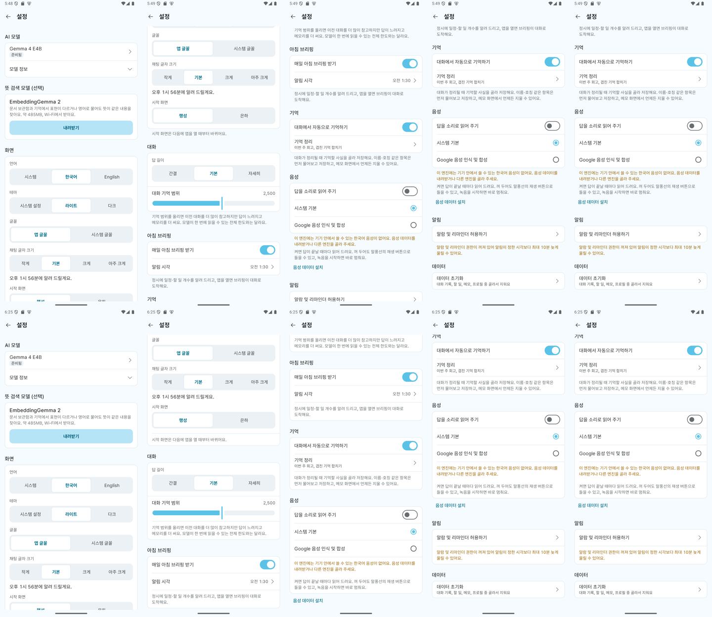
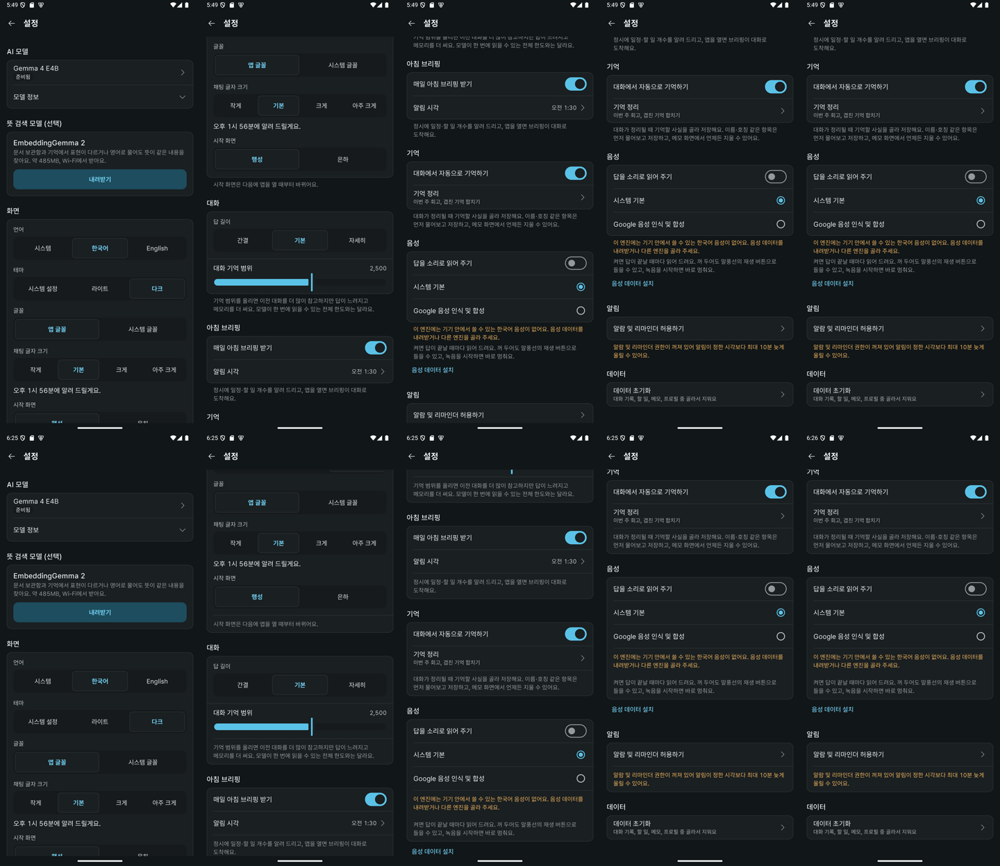
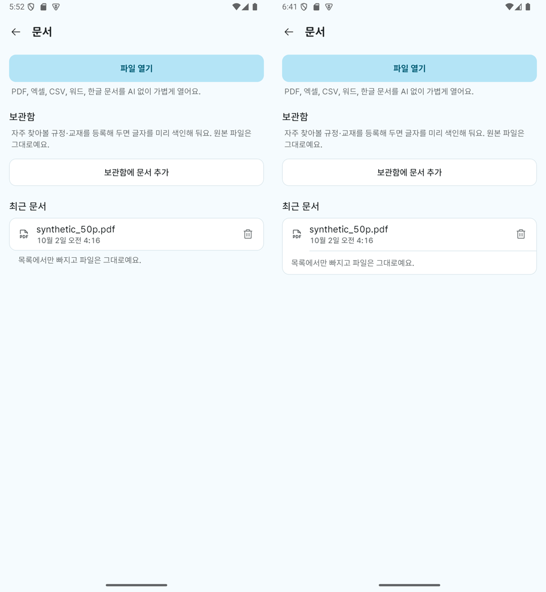
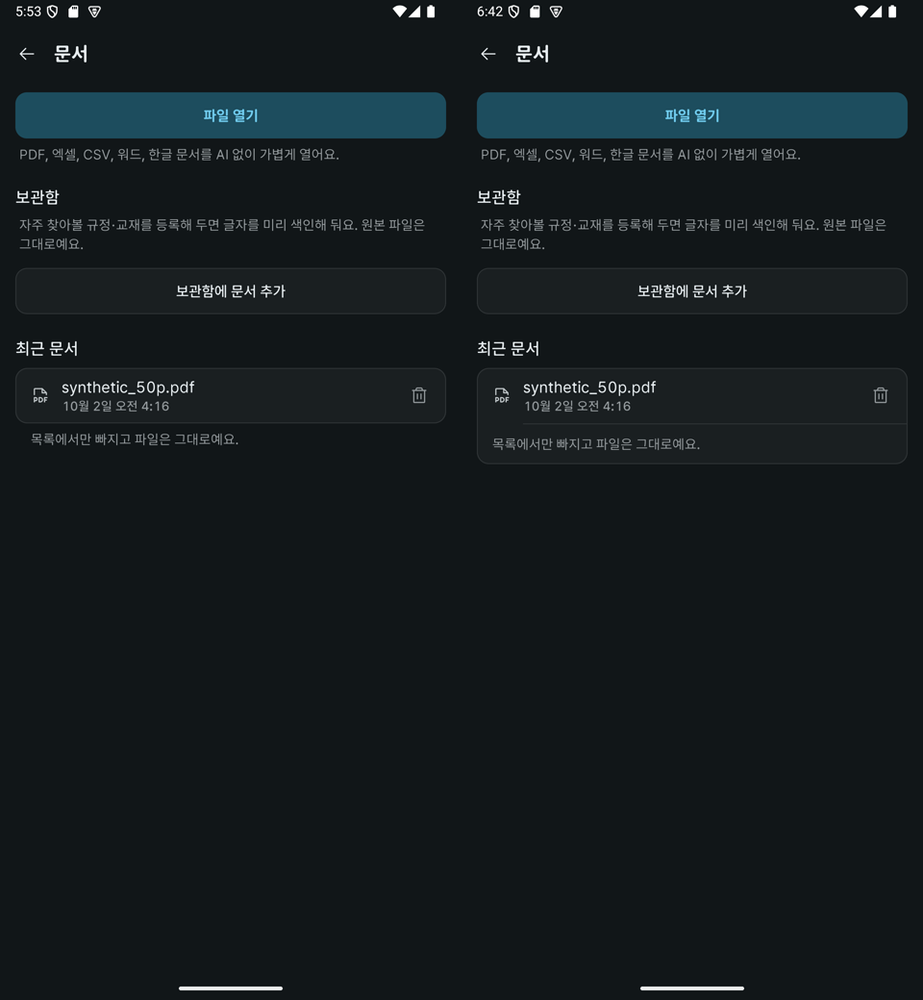

# 각주 위치 — 묶음 밖 → 묶음 안 (0.42.2)

> 사용자 결정 2026-11-17: 설정 화면에서 어떤 설명은 박스 안, 어떤 설명은 박스 밖이라 거슬렸다 → 같은 문법(0.38.3 "묶음 아래 각주")을 쓰는 화면 전체를 **묶음 안**으로.
> 설정 밖 화면은 사용자가 따로 본 적이 없어 바뀐 모습을 여기 남긴다. 캡처: 에뮬레이터 `my_phone`(1440×3120), 한국어, 위 줄 = 바꾸기 전, 아래 줄(또는 오른쪽) = 바꾼 뒤.
> 규칙: 묶음 **뒤** 각주·경고는 묶음 안 맨 아래, 묶음 **앞** 구역 소개·고르는 법 안내는 제목 아래 글 그대로(`docs/DESIGN.md` 화면 문법). 구현: `ui/component/KosmosList.kt` `KosmosListCaption`.
> 처음엔 앞 안내(문서 보관함 소개·기억 정리 안내)도 묶음 안 맨 위로 넣었으나, 문서가 없을 때 안내만 든 상자가 버튼처럼 보여(사용자 확인) 되돌렸다.

## 바뀐 곳

| 화면 | 설명 | 전 | 후 |
|---|---|---|---|
| 설정 · 화면 | "시작 화면은 다음에 앱을 열 때부터 바뀌어요." | 묶음 아래 | 묶음 안 맨 아래(구분선 위) |
| 설정 · 대화 | 대화 기억 범위 설명 | 묶음 아래 | 묶음 안 맨 아래 |
| 설정 · 아침 브리핑 | 알림 시각 설명(켰을 때만) · 알림 권한 경고 | 묶음 아래 | 묶음 안 맨 아래 |
| 설정 · 기억 | 자동 기억 설명 | 묶음 아래 | 묶음 안 맨 아래 |
| 설정 · 음성 | 한국어 음성 없음 경고(주황) · 낭독 설명 | 묶음 아래 | 묶음 안 맨 아래(경고 먼저) |
| 설정 · 알림 | 정확한 알람 권한 경고(권한 없을 때만) | 묶음 아래 | 묶음 안 맨 아래 |
| 문서 · 보관함 | 보관함 각주(문서가 있을 때만) | 추가 버튼 아래 | 묶음 맨 아래 조각(추가 버튼보다 위) |
| 문서 · 최근 문서 | "목록에서만 빠지고 파일은 그대로예요." | 묶음 아래 | 묶음 맨 아래 조각 |

**그대로 둔 것**: 묶음 앞 안내(문서 보관함 "자주 찾아볼 규정·교재를…", 기억 정리 "합칠 것만 골라 주세요…"·"같은 일이 끊겨…"), 버튼 바로 밑 한 줄(문서 "PDF, 엑셀…AI 없이 가볍게 열어요", 설정 "음성 데이터 설치" 글자 버튼), 빈 상태 글("겹치는 기억이 없어요"), 모델 관리·뜻 검색 모델 칸(이미 묶음 안).
서랍·활동 기록·메모·할 일·일정 화면에는 묶음 밖 설명이 없었다.

## 비교

### 설정 (라이트 · 다크) — 위 5장 전, 아래 5장 후

### 문서 (라이트 · 다크) — 왼쪽 전, 오른쪽 후

보관함에 문서가 있을 때(각주가 추가 버튼 위, 묶음 안으로)는 화면 기준 이미지 `app/src/test/screenshots/34-documents-library-light.png` 에서 볼 수 있다.
